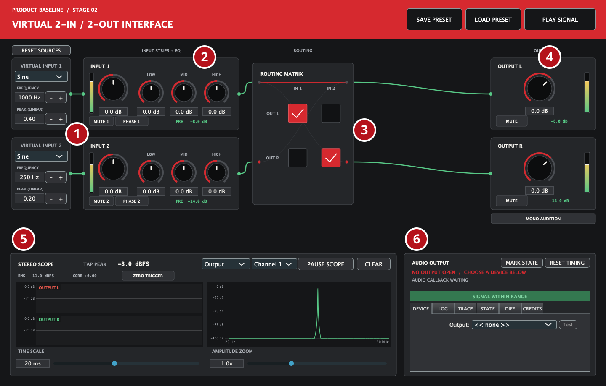
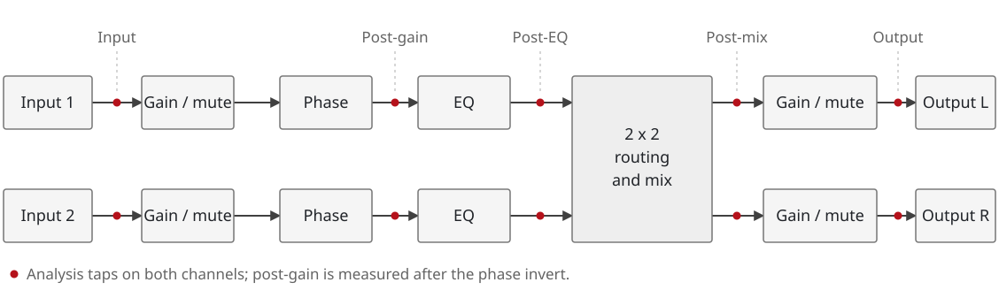
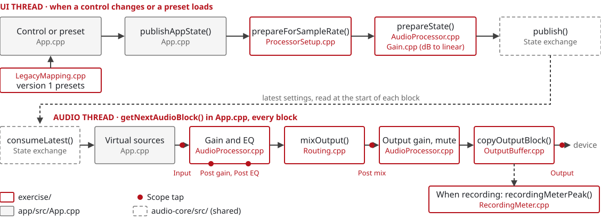

# App Overview

Three diagrams of the workshop app: what the controls do, how the audio flows,
and how the code is organised. They are the same diagrams as the workshop slides.

## Application Controls

1. **Sources:** two virtual inputs. Choose the waveform, frequency and peak level.
   **RESET SOURCES** puts them back to the exercise's values.
2. **Input strips:** gain, mute, phase invert and a three-band EQ for each input.
3. **Routing:** send either input to either output. Rows are outputs, columns are
   inputs.
4. **Outputs:** gain, mute and a level meter for Output L and Output R.
   **MONO AUDITION**, under the outputs, plays (L+R)/2 on both.
5. **Analysis:** a two-lane scope (one lane per channel, on a shared time axis) and
   a spectrum at the selected tap and channel, with peak, RMS and correlation.
6. **Diagnostics:** audio device and buffer settings, callback timing, and the
   LOG, TRACE, STATE and DIFF tabs.

## Signal Chain

Each input passes through its gain, phase and EQ. The routing matrix mixes both
inputs into each output, then each output has its own gain and mute. The red
taps are the points the scope and meters can measure: Input, Post gain (which
includes the phase invert), Post EQ, Post mix and Output.

The inputs are virtual and the outputs go to your computer's audio device, so no
audio interface is needed. The app and the tests run the same C++
processing code.

## Software Architecture

The app runs on two threads:

- **UI thread:** when a control changes or a preset loads, `App.cpp` calls
  `prepareForSampleRate()`, which calls `prepareState()` to turn the controls into
  processing settings (converting decibels to gains, for example). The prepared
  settings are then published. Version 1 presets go through `LegacyMapping.cpp`
  first.
- **Audio thread:** at the start of every block, `App.cpp` picks up the latest
  settings, generates the two sources, runs the processing and copies the result
  to the device.

The two threads only meet at the state exchange. Boxes outlined in red are the
files in `exercise/`, the code you work on in each exercise. Grey
boxes are the JUCE app and dashed boxes are the shared core. Each exercise's
tests call the same red-outlined files directly, without `App.cpp`.

Use the diagram to turn a measurement into a place to look: if the signal is
right at one tap and wrong at the next, the code between those taps is where to
start.
